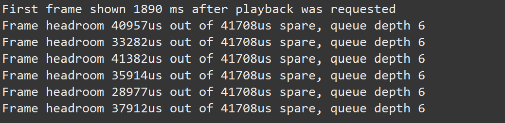
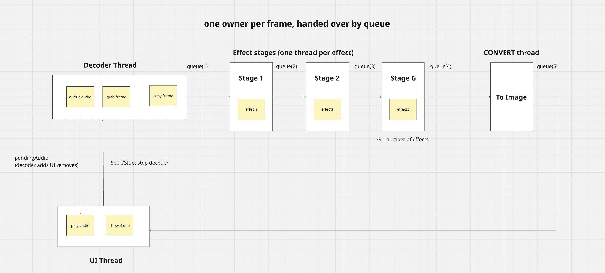
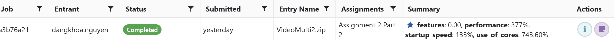

# Video Player (Multi-Threaded)

COMP3011 Assignment 2, University of Adelaide. Author: Dang Khoa Nguyen (a3141297).

A JavaFX video player with stackable "old film" effects. The starter code ran everything on one thread, so
it fell behind real time as soon as a few effects were stacked. This version splits the work across threads
in a **pipeline**, so many more effects can be stacked before playback falls behind, while the window stays
responsive and the picture stays identical to the original.

**In one sentence:** each effect runs on its own thread and frames move from thread to thread through small
queues, like an assembly line, so the speed limit is the slowest single effect and not the sum of all of them.

---

## 1. Build, run and test

All commands run from the folder that contains `pom.xml`.

| Command | What it does |
|---|---|
| `mvn validate` | Checks the project is valid |
| `mvn compile` | Compiles `src/main/java` |
| `mvn package` | Builds the jar (also runs the quick unit tests) |
| `mvn javafx:run '-Djavafx.args=movie.mp4 -nsfwyvdjmbp'` | Plays a video with effects |
| `mvn javafx:run -Dplayer.debug=true '-Djavafx.args=movie.mp4 -nsfwyvdjmbp'` | Same, and prints timing lines (see section 6) |
| `mvn verify` | Runs the unit tests **and** the load test |

In Eclipse, use *Run As > Maven build* with the same goals. Put the arguments in the `javafx.args` parameter, and add a
`player.debug` parameter with the value `true` if you want the timing lines, like in the example below.



### Choosing effects (Part 1)

Effects are chosen on the command line and applied **in the order typed**. They can be repeated and stacked.

| Short | Long | Effect |
|---|---|---|
| `n` | `--number-frames` | Frame number |
| `s` | `--scratch-frames` | Film scratches |
| `f` | `--flicker-frames` | Flicker |
| `w` | `--black-and-white` | Black and white |
| `y` | `--yellow-frames` | Yellow tint |
| `v` | `--vignette-frames` | Dark corners |
| `d` | `--dust-frames` | Dust |
| `j` | `--jitter-frames` | Jitter |
| `m` | `--mottle-frames` | Mottling |
| `b` | `--bleed-frames` | Bright areas bleed |
| `p` | `--pepper-frames` | Pepper noise |

`-nssn` means number, scratch, scratch, number. `--help` lists everything. Adding an effect needs one new line in
`FrameProcessorOption`.

---

## 2. The problem with the original design

One thread did everything: decode, every effect in turn, convert, drawing, audio, and the window.

```
UI thread:  [decode][effect 1][effect 2] ... [effect N][convert][show]   one frame at a time
```

At 24 fps each frame has **41,667 µs**. Timings on a development machine (HD frame, 11 effects):

| Step | Time |
|---|---|
| Decode | about 0.9 ms |
| Effects, all 11 in turn | about 28 ms (Bleeder 8.3, Vignetter 6.2, Mottler 5.5, Black-and-white 4.1) |
| Convert to an image | about 2.5 ms |
| **Total** | **about 31 ms, so nearly the whole budget** |

Three problems followed:
- The speed limit was the **sum** of all effects.
- Only one core did the work.
- There was a single frame slot with no buffer, so one slow frame was a visible stutter, and the window froze while a frame was made.

---

## 3. The new architecture

A *stage* is one thread that takes a frame from an input queue, does one job on it, and puts it on
an output queue. A *pipeline* is a chain of stages joined by queues.



`queue(1)` to `queue(5)` are the waiting lines between threads. Each holds 1 frame, except the last one (before the
display), which holds up to 6.

### Threads

| Thread | Count | Job |
|---|---|---|
| Decoder | 1 | Reads frames, queues audio, copies each frame, feeds the first queue |
| Effect threads | One per effect (G = number of effects) | Each runs its one effect on every frame, in order |
| Convert | 1 | Builds the JavaFX image |
| UI (JavaFX) | 1, not ours | Takes finished images, shows them when due, plays audio, handles the window |

The effect threads run a little below normal priority, and at most (cores − 1) of them work at the same moment, so one
core always stays free for the UI thread and everything else. `-Dplayer.maxConcurrentEffects=N` changes that limit for experiments.

### Why it is faster

Different frames are in different stages at the same time, so the speed limit becomes the **slowest stage**, not the
sum of all of them. With the 11 effects the slowest stage is Bleeder at about 8 ms, against 31 ms in series. The UI thread
only shows frames, so the window stays responsive.

A frame still goes through every effect in order, so the first frame is not faster. What improves is how often a
finished frame comes out: once the line is full, one frame comes out every step of the slowest stage.

---

## 4. Design decisions and why

| Decision | Why |
|---|---|
| **One owner at a time.** A frame is held by one thread and handed over through a queue. | The pixels need no locks. A queue hand-off is the only synchronisation. |
| **One thread per effect instance.** | Jitterer, Mottler and Bleeder keep scratch buffers that change while they run. Two frames in the same instance at once would corrupt each other. |
| **Bounded queues** (1 between stages, 6 before the display). | A fast stage waits for a slow one (back-pressure), so memory cannot grow without limit. An HD frame is several MB. The 6 slots also hide one slow frame from the display. |
| **Frames are copied** (`Frame.clone()`) when they enter the pipeline. | The grabber reuses one `Frame` and overwrites it on the next grab. The copy gives each frame one owner. It is freed after conversion. |
| **Effects keep their order.** | Effects do not commute (black-and-white then yellow is not yellow then black-and-white), and the output must match the reference. |
| **Effect threads run below normal priority, and at most (cores − 1) effects work at once.** | With 40 effects there are far more busy threads than cores. On TITAN the top rung used 7.7 of 8 cores and a screenshot of the window sometimes timed out. Keeping one core free for the UI thread and the tools around it makes that less likely, and it costs about one core of speed. |
| **Convert is its own stage.** | Its cost (about 2.5 ms) is not added to the last effect. |
| **The clock starts when the first frame is shown**, not when it was decoded. | A frame can wait in a queue. That waiting must not make it look late. |
| **The UI thread uses `poll()`, never `take()`.** | The UI can never wait on a queue and freeze. |
| **The audio line opens only when sound is on.** Audio is only decoded while sound is on. | Opening and warming up the sound line is slow and was done even without `-a`. This gave a faster start. |
| **Timing lines print only with `-Dplayer.debug=true`.** | Printing from the UI thread can block it if the reader of our output is slow, and a blocked UI thread shows up as dropped frames. |
| **Daemon threads.** | They cannot keep the program alive after the window closes. |

### What was removed and replaced

| Removed from the starter | Replaced by | Why |
|---|---|---|
| Decode, all effects and convert, run one after another on the UI thread | Decoder thread, one thread per effect, convert thread (`FramePipeline`) | The old way used one core and its speed limit was the sum of all effects. It also froze the window while each frame was made. |
| A single frame slot, with no buffer | Bounded queues (1 slot between stages, 6 before the display) | One slow frame was a visible stutter. The 6 slots hide it, and the bounds keep memory from growing. |
| Effects hard-coded in the model | An effect list built from the command line (`FrameProcessorOption`) | This is what Part 1 needs: effects chosen in the order typed, and repeatable. |
| The audio line opened every time | The audio line opened only when sound is on (`openAudioPlayer()`) | Opening it is slow, so it delayed startup for users who never turned sound on. |
| The UI thread doing the frame work | The UI thread only shows frames that are due, using `poll()` | The window can no longer freeze waiting for a frame. |

### Alternative I tried and why I did not keep them

| Alternative | What happened |
|---|---|
| **Worker pool:** each worker applies every effect to its own frame, with frame numbers to restore the order | Effects keep scratch buffers, so each effect needed a lock, and finished frames had to wait for earlier ones. It dropped frames on TITAN. A copy of every effect per worker would avoid the locks, but each effect's random seed depends on how many have been created, so the copies would need changes to the effect classes. |

---

## 5. Thread safety: shared data and how it is protected

| Shared data | Used by | Protection |
|---|---|---|
| Frames in the pipeline | Decoder, stages, convert | One owner at a time, queue hand-off |
| Each effect instance | One stage thread | Confined to that thread |
| Number of effects working at once | All effect threads | A fair `Semaphore`, held only while inside an effect and never while waiting on a queue, so it cannot deadlock |
| `grabber` | Decoder thread (UI thread only while the decoder is stopped) | Confined, plus `join()` before the UI thread touches it |
| `converter` | Convert stage | Confined |
| `pendingAudio` | Decoder adds, UI removes | `ConcurrentLinkedQueue`: thread-safe, first-in first-out, no locks, so the UI thread never waits for the decoder |
| `audioOutputEnabled`, `audioPlayer` | UI writes, decoder reads | `volatile`: a single value that one thread writes and another reads, so each always sees the latest one. `audioPlayer` is stored only after the line is fully open. |
| Clock, `nextFrame`, pause state | UI thread only | Confined |
| Effect set-up (`initialise`) | Done by the decoder before the first frame enters the pipeline | The queue `put`/`take` makes it visible to the stage threads |

There are no `synchronized` blocks. Where data is shared it is either handed over through a queue or declared thread-safe.

### Seek, pause, stop and the end of the video

- **Seek and stop:** stop the decoder first (`interrupt`, then `join`), then stop every stage (`interrupt` all, `join`
  all), then empty every queue and free the unshown frames. Only then is the grabber moved and the threads restarted.
  The decoder is stopped first because it is the producer: if the pipeline were cleared while it still ran, one more old
  frame could slip in after the jump.
- **Pause:** the UI thread stops taking frames. The pipeline fills and its stages wait on full queues. On resume the clock
  is shifted by the length of the pause.
- **End of video:** the decoder sends a special `END` marker. Every stage passes it on, and the UI finishes when it arrives.
- **Errors:** a failing stage reports once to the UI thread, which stops playback and shows the message. Errors from threads
  that were already stopped are ignored. A stop request (`interrupt`) is not treated as an error.

---

## 6. Performance

### Reading the console

Run with `-Dplayer.debug=true` to print a line once per second:

```
Frame headroom 36177us out of 41708us spare, queue depth 6
```

| Value | Healthy | Behind |
|---|---|---|
| headroom | Close to the full frame time (for example 36,000 of 41,708 µs) | Negative: the frame was shown more than a whole frame late |
| queue depth | 4 to 6 | Sinks to 0: the effects cannot keep up |

The line `First frame shown N ms after playback was requested` reports startup time. Without the option nothing is printed.

### Results

TITAN relative to the supplied single-threaded reference player (100% is the same as the reference). This is the best
completed run, made before the core limit was added:



### Limitations and trade-offs

- Turning sound on for the first time opens the audio line, which takes about a second and briefly freezes the window.
  Starting with `-a` delays the start by the same time. I accepted this because opening it for every user slowed startup for
  people who never use sound. A background thread could open it without the freeze.
- Each frame is copied once on entry (about 1 to 2 ms) and costs several MB while in flight.
- On machines with hyper-threading, extra threads give less than a full core each, so the speed-up is less than the core count.
- Seek and stop wait (on the UI thread) for the decoder and every effect to finish the frame they are on, so a seek can
  pause the window for a few milliseconds.
- Opening the video file still happens on the UI thread, so it is the largest remaining startup cost.

---

## 7. Code map

| File | Role |
|---|---|
| `VideoPlayerApp`, `VideoPlayerAppLauncher` | Start the program |
| `CommandLineController`, `FrameProcessorOption` | Read the command line and build the effect list (Part 1) |
| `VideoPlayerController`, `VideoPlayerView` | Keys, buttons and the window |
| `VideoPlayerModel` | Decoding, the clock, seek/pause/audio |
| `FramePipeline` | Builds the chain of stages and queues, starts and stops it |
| `PipelineStage` | One thread: take a frame, do one job, hand it on |
| `FrameJob` | One frame on its way through the pipeline, and the `END` marker |
| `PendingAudio` | A piece of sound waiting to be played |
| `FrameProcessor` and the 11 effect classes | The effects. Unchanged, so their output is identical to the original. |
| `AudioPlayer`, `InfoVideo`, `InfoFrame` | Sound output and small data records |

---

## 8. Documentation

| Document | What it covers |
|---|---|
| [AI Usage](docs/AIUSAGE.md) | Where AI tools were used in this assignment, and what I changed or checked myself |
| [Testing](docs/TESTING.md) | The unit tests and the load test, what each one proves, and how to run them |